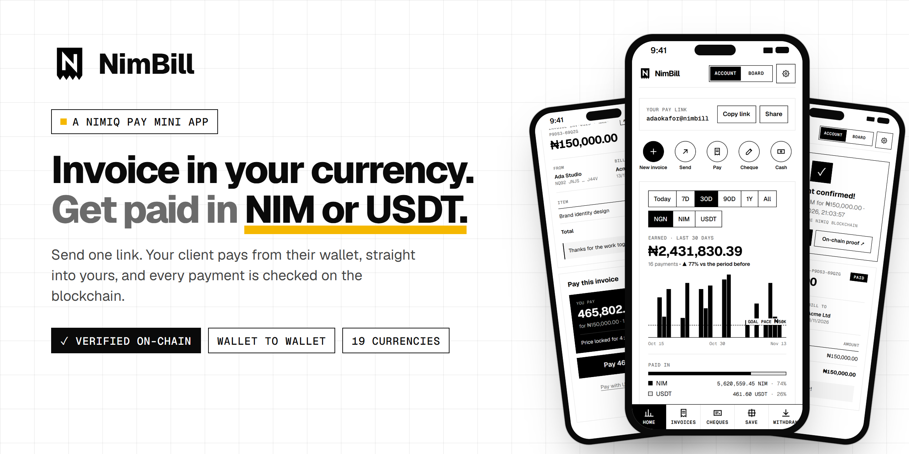
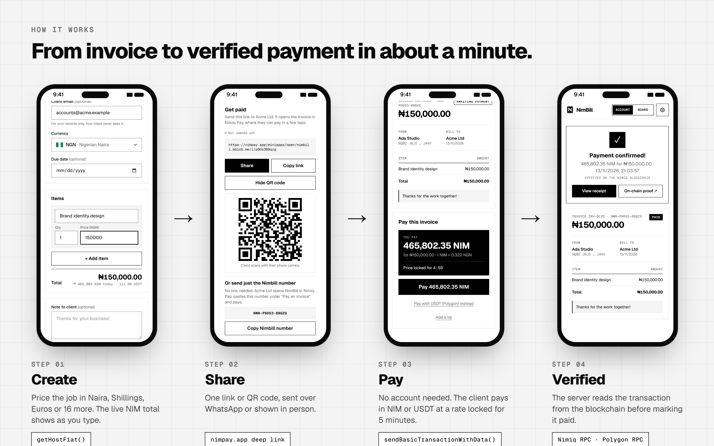
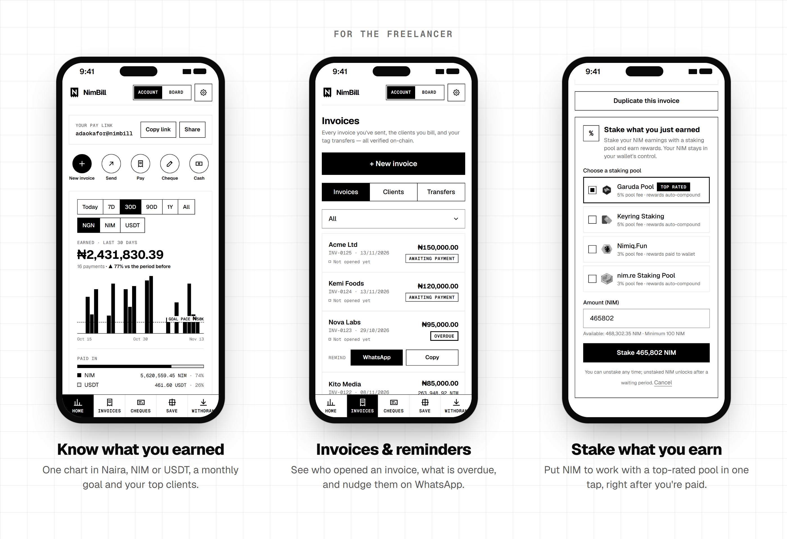
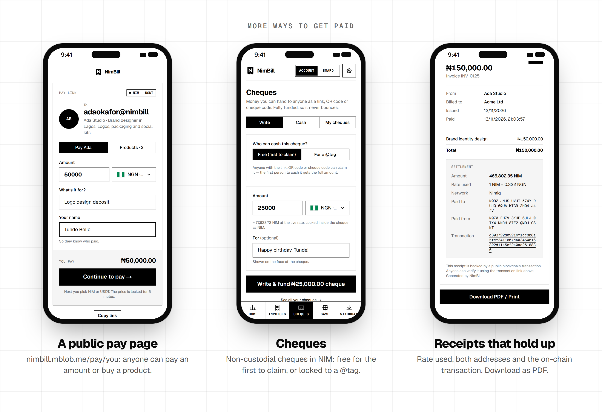
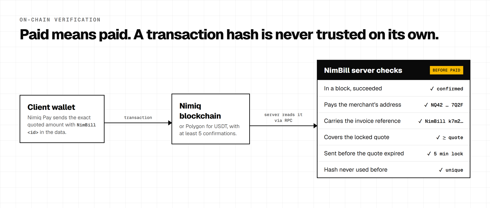
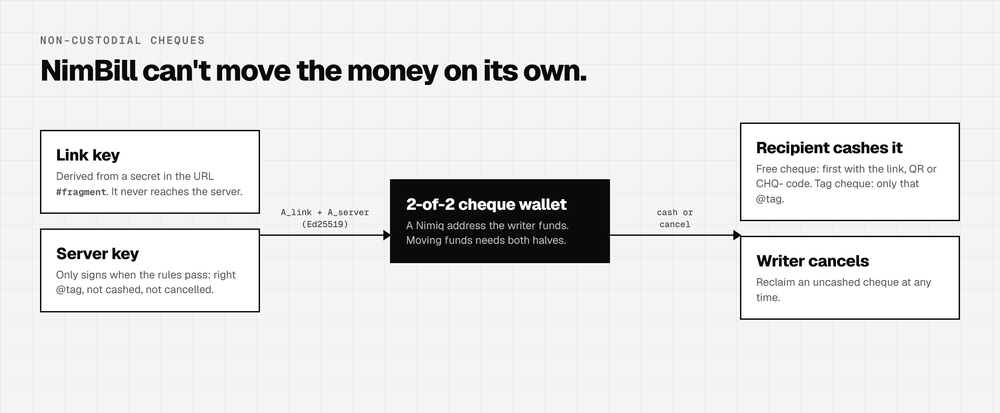
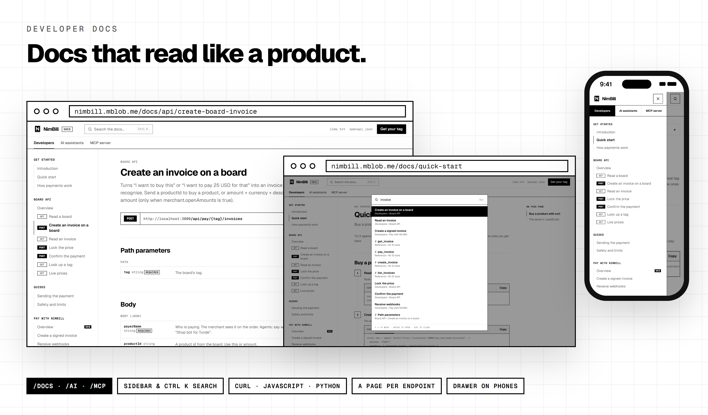
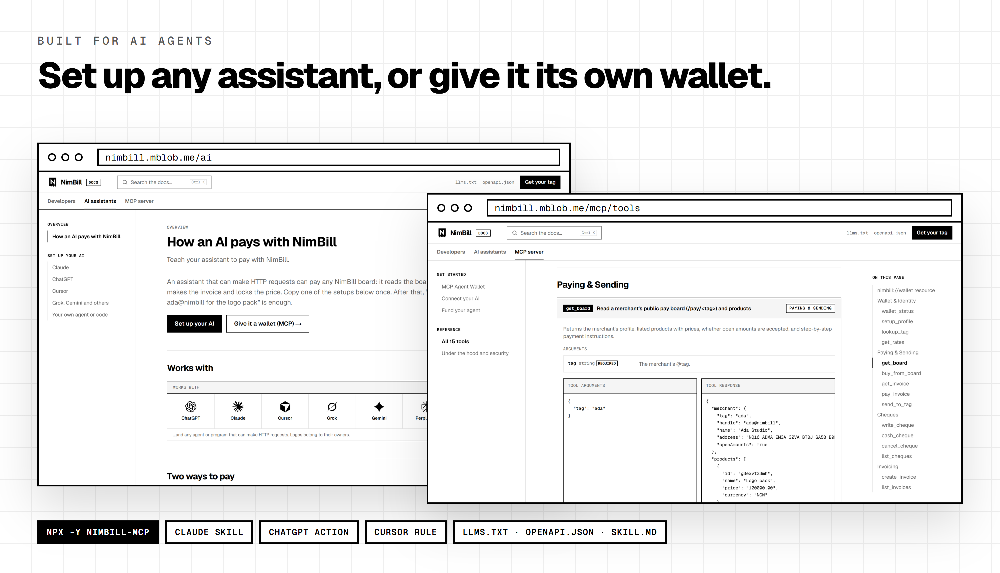
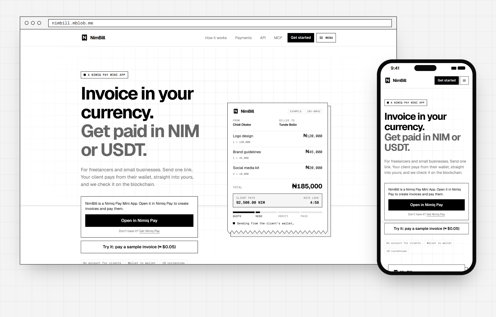

<p align="center">
  
</p>

<p align="center">
  <a href="https://nimbill.mblob.me"><b>Live app</b></a> ·
  <a href="demo/nimbill-demo.mp4"><b>96-second demo video</b></a> ·
  <a href="https://nimbill.mblob.me/docs"><b>Developer docs</b></a> ·
  <a href="https://nimbill.mblob.me/docs/webhooks"><b>Pay with NimBill</b></a> ·
  <a href="https://nimbill.mblob.me/ai"><b>AI setups</b></a> ·
  <a href="https://nimbill.mblob.me/mcp"><b>MCP agent wallet</b></a> ·
  <a href="https://nimbill.mblob.me/stats"><b>Live usage, with on-chain proof</b></a>
</p>

<p align="center">
  
  
  <a href="https://www.npmjs.com/package/nimbill-mcp"></a>
  
</p>

# NimBill: invoices paid in NIM & USDT

A [Nimiq Pay](https://nimiq.com/nimiq-pay) Mini App for freelancers and small businesses. **Invoice clients in your local currency, get paid in NIM or USDT straight to your wallet, with every payment verified on-chain.**

Built for the [Nimiq Mini Apps Competition — Cycle III](https://miniappscompetition.com/cycle3), **Pay** category.

> **Try it in 30 seconds:** open the [live app](https://nimbill.mblob.me) in Nimiq Pay and tap **"Pay a sample invoice"**. It runs the whole flow, from quote to on-chain receipt, for about $0.05.

|                                   |                                                                                              |
| --------------------------------- | -------------------------------------------------------------------------------------------- |
| **No account for clients**        | They open one link in Nimiq Pay and pay in a few taps.                                       |
| **Wallet to wallet**              | NimBill never holds funds.                                                                   |
| **Verified on-chain**             | The server reads every payment from the blockchain before an invoice is marked paid.         |
| **19 currencies**                 | Naira, Shillings, Cedis, Euros, Rupees and more, at a live rate locked for 5 minutes.        |
| **Made for people and AI agents** | A public JSON API, an OpenAPI spec, and an MCP server that gives an agent its own wallet.    |
| **Pay with NimBill for stores**   | Your store creates invoices, customers pay wallet to wallet, and a signed webhook says when. |

## How it works



1. **Create.** Price the job in your currency. The live NIM total shows as you type.
2. **Share.** Send one link over WhatsApp, use the share sheet, show a QR code in person, or read out a short `NMN-` number.
3. **Pay.** The client taps **Get price**. The fiat total is converted at the live rate, rounded **up** so you never get less than you invoiced, and **locked for 5 minutes**.
4. **Verified.** The server checks the transaction on the blockchain, then both sides get a receipt with the rate used and a link to the transaction.

## Features



- **Earnings at a glance.** One chart in Naira, NIM or USDT, split by coin, with top clients and a monthly income goal that shows the daily pace you need.
- **Invoices and reminders.** Line items, due date and note. See when a client opens an invoice, spot overdue ones, and send a one-tap payment reminder. Export to CSV for your accountant.
- **Stake what you earn.** After a NIM payment, stake it with a top-rated pool in one tap. The dashboard shows what is staked and where, and lets you stake more, unstake, and move unstaked NIM back once the waiting period ends.
- **Know when you are paid.** Add an email in Settings (optional) and NimBill emails you once when an invoice is paid. This needs `RESEND_API_KEY` on the server.



- **A tag instead of an address.** Every user claims a tag like `ada@nimbill`. Lookalike-safe rules and reserved names, and a given-up tag stays held for its owner for 90 days.
- **A public pay page.** `/pay/<tag>` lets anyone pay you without an account: an amount for something, or one of your products (with a quantity). Visitors' invoices get your next `INV-` number only once paid, so unpaid ones never leave gaps. They appear under Board → Orders.
- **Products.** Name, price, description and a picture. Pictures are shrunk in the browser and stored in the database, so there is no file storage to set up.
- **Send money by tag.** Type a tag, check the name and address it belongs to, and send NIM, or USDT on Polygon to anyone who added a Polygon wallet (amount in the coin or any supported currency). Transfers are verified on-chain like invoices. USDT has no memo, so each USDT transfer gets a unique exact amount and is matched by both wallets, that amount and when it was sent; no open invoice to the same wallet uses that amount, and one transaction never counts as both a transfer and an invoice payment.
- **Cheques** (`/cheques`, `/c/<id>`). Write a cheque in NIM or any supported currency, either locked to one `@tag` or open to the first person with the link, QR code or `CHQ-…` code. [How cheques stay non-custodial ↓](#non-custodial-cheques)
- **Coins and currencies you can recognise.** The real NIM and USDT logos appear wherever a coin is mentioned, and every currency picker shows the country's flag.
- **Receipts that hold up.** The rate used, both addresses and a link to the transaction. Download as PDF.
- **Public usage page** (`/stats`). Every paid invoice links to its on-chain transaction.

## How payment verification works



1. The client taps **Get price**. The server creates a quote: the fiat total ÷ the live CoinGecko rate, rounded **up**. The quote expires after 5 minutes.
2. The wallet sends the exact amount. NIM payments carry `NimBill <invoiceId>` as transaction data.
3. The client polls `/api/invoices/:id/verify` with the transaction hash. The server reads the transaction from a Nimiq RPC node (or a Polygon RPC node for USDT) and checks:
   - it succeeded and is in a block (for Polygon, at least 5 confirmations);
   - it pays the merchant's address;
   - for NIM, the data matches the invoice reference;
   - the value is at least the quoted amount, and it was sent before the quote expired (plus a short grace period).
4. Each transaction hash can pay **only one** invoice (database unique constraint).
5. If the client closes the app before confirmation, the merchant's dashboard finds the payment later by scanning the merchant's recent transactions for the invoice reference.

## Non-custodial cheques



Each cheque is its own 2-of-2 Ed25519 Nimiq wallet (`A_cheque = A_link + A_server`). The link secret lives only in the URL `#fragment`, so it never reaches NimBill's server. NimBill can therefore never move the funds on its own, and the writer can cancel and reclaim an uncashed cheque at any time.

## Pay with NimBill: webhooks for online stores


Take NIM and USDT in your own shop without NimBill ever holding the money. There is **no API key**: one webhook secret signs both ways.

1. **Turn it on** in Settings → Webhooks: your https webhook URL and, optionally, your store's address. The secret is shown once and stored encrypted.
2. **Your server creates the invoice** with [`POST /api/pay/{tag}/invoices`](https://nimbill.mblob.me/docs/api/create-board-invoice), signed with the secret, adding your order `reference`, `metadata` and a `returnUrl` back to your store.
3. **The customer pays** at `/i/{id}` from Nimiq Pay or any wallet, and a **Back to your shop** button returns them.
4. **Your server gets `invoice.paid`**, signed the same way and retried for about 3 days until it answers 2xx. **Send test event** delivers a `webhook.test`, so you can check your handler without paying.

```text
NimBill-Signature: t=<unix seconds>,v1=<hex HMAC-SHA256(secret, "<t>.<raw body>")>
```

<details>
<summary>Verify a webhook in Node.js</summary>

```js
import { createHmac, timingSafeEqual } from "node:crypto";

// header: the NimBill-Signature header; rawBody: the request body exactly as received.
export function isFromNimBill(header, rawBody, secret) {
  const parts = header.split(",").map((p) => p.split("="));
  const t = Number(parts.find(([k]) => k === "t")?.[1]);
  if (!t || Math.abs(Date.now() / 1000 - t) > 300) return false; // older than 5 minutes
  const expected = Buffer.from(createHmac("sha256", secret).update(`${t}.${rawBody}`).digest("hex"));
  // While a rotated-out secret is still valid, there is one v1= per secret.
  return parts.some(([k, v]) => k === "v1" && v.length === expected.length && timingSafeEqual(Buffer.from(v), expected));
}
```

Then find the order by the `invoice.id` you saved, check the total and currency, and skip event ids you have already handled (delivery is at least once).

</details>

- **A worker you run next to the app** ([`worker/`](worker/README.md), `npm run worker` or its Dockerfile). It opens no port: it delivers queued events, watches the chain for store payments (so a closed tab doesn't matter), and re-queues any paid store invoice that is missing its webhook.
- **Safe outgoing requests.** Webhooks only go to public https hosts; the resolved address is checked and pinned, and redirects are not followed.
- **Rate limits you can read.** Limited endpoints answer with `RateLimit-Limit`, `RateLimit-Remaining` and `RateLimit-Reset` (plus `Retry-After` on 429), readable from other sites too. Signed store requests get their own, larger allowance.

Full guide: [Pay with NimBill](https://nimbill.mblob.me/docs/webhooks).

## Developer docs



[`/docs`](https://nimbill.mblob.me/docs), [`/ai`](https://nimbill.mblob.me/ai) and [`/mcp`](https://nimbill.mblob.me/mcp) share one docs layout built into the app, so everything stays one Vercel project:

- **Find things fast.** A sidebar per area, search over every page and heading (Ctrl K), an "On this page" list that follows your scroll, and Previous/Next links. On a phone the sidebar becomes a drawer.
- **A page per endpoint.** [Read a board](https://nimbill.mblob.me/docs/api/get-board), [create an invoice](https://nimbill.mblob.me/docs/api/create-board-invoice), [lock the price](https://nimbill.mblob.me/docs/api/create-quote), [confirm the payment](https://nimbill.mblob.me/docs/api/verify-payment) and more, each with its fields, an example request in **curl, JavaScript and Python** (your choice is remembered), an example response and its errors.
- **One source of truth.** The endpoint pages, `/openapi.json`, `/llms.txt`, `/skill.md` and every board's `howToPay` are generated from the same files (`src/lib/api-reference.ts`, `src/lib/agent-docs.ts`), so they can't disagree.
- Start with the [quick start](https://nimbill.mblob.me/docs/quick-start): buy a product from a board with five requests.

## Built for AI agents



- **Set up any assistant** at [`/ai`](https://nimbill.mblob.me/ai): a skill for [Claude](https://nimbill.mblob.me/ai/claude), a custom GPT action for [ChatGPT](https://nimbill.mblob.me/ai/chatgpt), a project rule for [Cursor](https://nimbill.mblob.me/ai/cursor), and instructions for [Grok, Gemini and other chats](https://nimbill.mblob.me/ai/other). Every board's JSON also includes the exact steps to pay it.
- **Machine-readable.** [`/llms.txt`](https://nimbill.mblob.me/llms.txt), [`/openapi.json`](https://nimbill.mblob.me/openapi.json) and [`/skill.md`](https://nimbill.mblob.me/skill.md).
- **CORS for browser agents.** The public endpoints allow cross-site requests. Signed-in endpoints and owner actions stay closed to other sites.
- **MCP agent wallet** ([`nimbill-mcp`](https://www.npmjs.com/package/nimbill-mcp) on npm). Gives Claude, Cursor, Windsurf or Antigravity its own non-custodial Nimiq wallet and `@tag`, with [15 tools](https://nimbill.mblob.me/mcp/tools) to pay invoices, buy from boards, send NIM by tag, and write or cash cheques on-chain. Spending limits and an encrypted key file are built in. See [Connect your AI](https://nimbill.mblob.me/mcp/connect) and [`mcp/README.md`](mcp/README.md).

```bash
claude mcp add nimbill -e NIMBILL_URL=https://nimbill.mblob.me -- npx -y nimbill-mcp
```

## How it uses Nimiq Pay

| Feature                                             | Nimiq Pay API                                                                                                          |
| --------------------------------------------------- | ---------------------------------------------------------------------------------------------------------------------- |
| Passwordless sign-in (proves wallet ownership)      | `nimiq.sign()`, verified server-side (Ed25519 over the Nimiq signed-message hash; address derived from the public key) |
| Pay an invoice in NIM, with the invoice ID on-chain | `nimiq.sendBasicTransactionWithData({ recipient, value, data: "NimBill <id>" })`                                       |
| Pay an invoice in USDT (Polygon)                    | `window.ethereum`: `wallet_switchEthereumChain`, `eth_call` balance checks, `eth_sendTransaction` (ERC-20 `transfer`)  |
| Stake earnings                                      | `nimiq.sendNewStakerTransaction()` / `nimiq.sendStakeTransaction()`, `nimiq.getBalance()`                              |
| Unstake and withdraw                                | `nimiq.sendSetActiveStakeTransaction()`, `nimiq.sendRetireStakeTransaction()`, `nimiq.sendRemoveStakeTransaction()`    |
| Default invoice currency                            | `getHostFiat()`                                                                                                        |
| Open links inside the app                           | `https://nimpay.app/miniapps/open/<url>` deep links                                                                    |

All wallet actions are triggered by an explicit tap. Cancelling a dialog shows a calm message and keeps your place. Outside Nimiq Pay, clients can still pay from any Nimiq wallet with a `nimiq:` payment link or QR code, and the invoice is matched by its on-chain reference.

## Works outside Nimiq Pay too



In a desktop browser the app works too, but wallet actions show an "Open in Nimiq Pay" prompt.

## Tech stack

- **Next.js 16** (App Router, TypeScript, Tailwind CSS 4), mobile-first
- **@nimiq/mini-app-sdk** for the Nimiq provider; **viem** for ERC-20 encoding
- **Postgres** via Drizzle ORM: [Neon](https://neon.tech) in production, embedded [PGlite](https://pglite.dev) locally (zero setup)
- **Nimiq RPC** ([rpc.nimiqwatch.com](https://rpc.nimiqwatch.com)), **Polygon RPC**, **CoinGecko** prices and the **Nimiq Validators API**
- `@noble/curves` and `@noble/hashes` for signature verification and cheque keys
- A small **webhook worker** (Node, no build step, no open port) that runs the app's own code from `src/lib`

## Run locally

```bash
npm install
cp .env.example .env.local   # set DEMO_MERCHANT_ADDRESS to your Nimiq address
npm run dev -- -H 0.0.0.0
```

Open `http://<your-computer's-LAN-IP>:3000` in Nimiq Pay → Mini Apps → Custom URL (your phone must be on the same Wi-Fi).

To try webhooks locally, also run the worker (see [`worker/README.md`](worker/README.md) for sharing the database with the dev server):

```bash
npm run worker
```

Tests:

```bash
npm run test:api        # 130+ end-to-end API checks against the running dev server, simulating wallets with throwaway keys
npm run test:tags       # tag rules, request validation, agent docs and the OpenAPI spec
npm run test:earnings   # earnings and goals maths
npm run test:address    # Nimiq address derivation
npm run test:mcp        # the MCP agent wallet's tools
npm run test:webhooks   # the NimBill-Signature format used both ways
```

## Deploy (Vercel + Neon)

1. Push this repo to GitHub (public, MIT).
2. Create a free Postgres database on [neon.tech](https://neon.tech) and copy the connection string.
3. Import the repo on [vercel.com/new](https://vercel.com/new) and add these environment variables: `DATABASE_URL`, `SESSION_SECRET` (32+ random characters), `CHEQUE_KEY_SECRET` (recommended: 32+ random characters, never rotate it while cheques are open), `DEMO_MERCHANT_ADDRESS` (your Nimiq address), and `WEBHOOK_KEY_SECRET` (32+ random characters) if stores will use webhooks. Tables are created automatically on first request.
4. Open `https://<your-app>.vercel.app` in Nimiq Pay → Mini Apps → Custom URL, and pay the sample invoice to check it end to end.
5. For webhooks, run the worker on any container host (Fly.io, Railway, Render, a VPS) with the same `DATABASE_URL` and `WEBHOOK_KEY_SECRET`, plus `SITE_URL`: `docker build -f worker/Dockerfile -t nimbill-worker .` ([details](worker/README.md)).

## Security notes

- No private keys or secrets are in the code. `SESSION_SECRET` and `DATABASE_URL` come from environment variables.
- Sessions are HMAC-signed, httpOnly cookies. Sign-in challenges are single-purpose, expire after 5 minutes and are bound to the host.
- Invoice links use unguessable random IDs. The public view never exposes the client's email or the merchant's notification email, and neither is written to logs.
- USDT has no on-chain memo, so a USDT payment is matched by recipient, amount and time window, and each transaction hash can be used only once.
- Cheque link secrets stay in the URL fragment and never reach the server, so a cheque can't be cashed or moved by NimBill alone.
- Store webhook secrets are encrypted at rest with `WEBHOOK_KEY_SECRET`, shown only once, and can be rotated with a 24-hour overlap. A leaked secret can only create invoices that pay the merchant.
- Webhooks are only sent to public https hosts; the resolved address is pinned and redirects are not followed.

## Roadmap

Recurring invoices · multi-language (via `window.nimiqPay.language`) · payouts to local bank / mobile money through licensed partners.

## Resources

|                      |                                                                                                                                                                                                                                                                                                                                                                     |
| -------------------- | ------------------------------------------------------------------------------------------------------------------------------------------------------------------------------------------------------------------------------------------------------------------------------------------------------------------------------------------------------------------- |
| **Try it**           | [Live app](https://nimbill.mblob.me) · [96-second demo video](demo/nimbill-demo.mp4) ([storyboard](demo/STORYBOARD.md)) · [Live usage with on-chain proof](https://nimbill.mblob.me/stats)                                                                                                                                                                          |
| **Developer docs**   | [Introduction](https://nimbill.mblob.me/docs) · [Quick start](https://nimbill.mblob.me/docs/quick-start) · [How payments work](https://nimbill.mblob.me/docs/how-it-works) · [Board API](https://nimbill.mblob.me/docs/api) · [Sending the payment](https://nimbill.mblob.me/docs/sending) · [Safety and limits](https://nimbill.mblob.me/docs/safety)              |
| **Pay with NimBill** | [Webhooks guide](https://nimbill.mblob.me/docs/webhooks) · [Worker README](worker/README.md)                                                                                                                                                                                                                                                                        |
| **AI assistants**    | [Overview](https://nimbill.mblob.me/ai) · [Claude](https://nimbill.mblob.me/ai/claude) · [ChatGPT](https://nimbill.mblob.me/ai/chatgpt) · [Cursor](https://nimbill.mblob.me/ai/cursor) · [Grok, Gemini and others](https://nimbill.mblob.me/ai/other) · [Your own agent](https://nimbill.mblob.me/ai/own-agent)                                                     |
| **MCP agent wallet** | [Overview](https://nimbill.mblob.me/mcp) · [Connect your AI](https://nimbill.mblob.me/mcp/connect) · [Fund your agent](https://nimbill.mblob.me/mcp/funding) · [All 15 tools](https://nimbill.mblob.me/mcp/tools) · [Security](https://nimbill.mblob.me/mcp/security) · [npm package](https://www.npmjs.com/package/nimbill-mcp) · [`mcp/README.md`](mcp/README.md) |
| **Machine-readable** | [llms.txt](https://nimbill.mblob.me/llms.txt) · [openapi.json](https://nimbill.mblob.me/openapi.json) · [skill.md](https://nimbill.mblob.me/skill.md)                                                                                                                                                                                                               |
| **Nimiq**            | [Nimiq Pay](https://nimiq.com/nimiq-pay) · [Mini App SDK](https://www.npmjs.com/package/@nimiq/mini-app-sdk) · [Mini Apps Competition, Cycle III](https://miniappscompetition.com/cycle3)                                                                                                                                                                           |

## About the screenshots

The screens above are the real NimBill interface, captured at phone and desktop size from a local development server with a throwaway test account (the webhook URL shown is a sample). The earnings history on the dashboard is sample data, and the wallet confirmation and "paid" result are simulated (no real NIM moved). To see a real payment, pay the sample invoice in the [live app](https://nimbill.mblob.me).

## License

[MIT](LICENSE)
