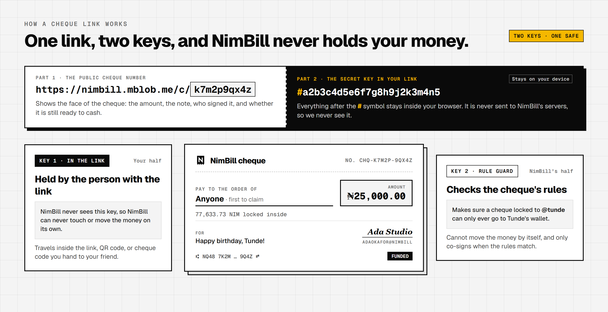
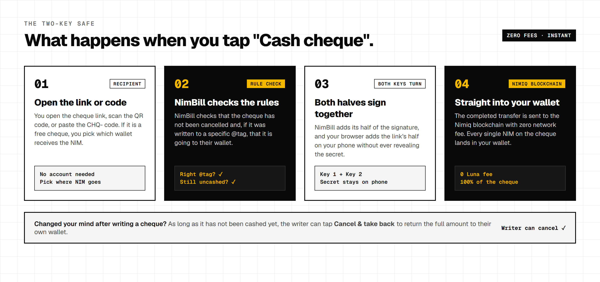
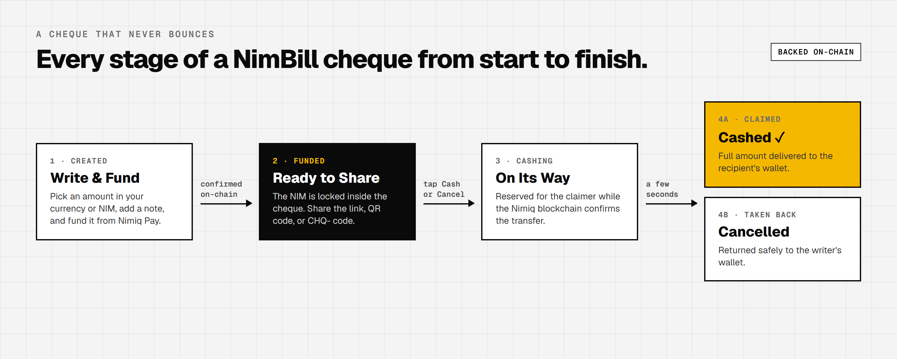

# How we built non-custodial cheques on Nimiq

> **Published on the NimBill Blog:** [nimbill.mblob.me/blog/how-we-built-cheques](https://nimbill.mblob.me/blog/how-we-built-cheques) · By [@mercichidi](https://x.com/mercichidi)

Every digital payment usually starts with the same mood-killing question: _"Hey, send me your wallet address."_ If you are paying a formal business invoice, asking for payment details makes sense. But if you want to send Tunde ₦25,000 for his birthday, tip someone in a community group chat, or hand a quick refund to a customer, asking for a long string of letters and numbers feels like asking a friend for their bank routing number at a birthday party.

Paper cheques solved this centuries ago. You write the amount on a slip of paper, sign your name, and hand it over. Of course, paper cheques had one notorious flaw: they could bounce if the writer's account was empty. When we set out to build **NimBill Cheques**, we wanted the warmth and simplicity of handing someone an envelope of cash, combined with the certainty of the Nimiq blockchain.

Here is how we built a digital cheque that never bounces, works in your local currency, and stays completely out of our hands so only you and your recipient can ever touch the money.

---

## Two ways to write a cheque: open to anyone, or locked to one person

When you open the Cheques tab in NimBill, you can write a cheque in NIM or in any of our 19 local currencies (including Naira, Shillings, Cedis, Euros, and Dollars). If you type an amount in your local currency, NimBill converts it at the live exchange rate and locks that NIM inside the cheque right away. Then you pick who can cash it:

- **A free cheque (first to claim).** Think of this like cash inside a greeting card. You can send the link over WhatsApp, print the QR code on a poster, or drop it into a group chat as a giveaway. The first person to open it and tap **Cash** gets the full amount.
- **A tag-locked cheque (made out to a @tag).** If you write a cheque to a specific NimBill user like **tunde@nimbill**, it works like writing their name on the "Pay to the order of" line. Even if someone else sees the link or scans the QR code, the cheque will refuse to pay anyone except Tunde.
- **Changed your mind? Take it back anytime.** Everyone has sent a message to the wrong chat at least once. As long as a cheque has not been cashed yet, the person who wrote it can tap **Cancel & take back** to return the full amount straight back to their own wallet.

---

## The big challenge: how do you enforce rules without becoming a bank?

Making a link that sends money sounds simple on the surface, until you ask a hard question: **where does the money sit while the cheque is waiting to be cashed?**

Most payment apps take one of two shortcuts, and both of them have a serious catch:

1. **Shortcut 1: Let the app hold the money.** The app takes your money into its own company account and waits for your friend to show up. That makes it easy to check who is cashing the cheque, but it turns the app into a middleman. If the company's servers ever go down or get hacked, every uncashed cheque is at risk. At NimBill, our number one rule is that we never hold your money.
2. **Shortcut 2: Put the entire key to the wallet inside the link.** You could create a temporary wallet for the cheque and put its full password inside the web link. Now the app never holds the money! The problem is that anyone who sees the link has total control over that wallet. You could never lock a cheque to **tunde@nimbill**, because a stranger who found the link could bypass the app entirely and empty the wallet themselves.

We wanted both protections at once. We needed a cheque where **NimBill can never touch the money on its own**, and at the same time, **nobody can break the rules written on the face of the cheque**.

---

## Our solution: a digital safe with two keys

Think of how a traditional bank vault or safety deposit box works. There is one lock for the bank manager and a second lock for the customer. Neither person can open the box alone. It only opens when both keys turn together.

Every single NimBill cheque gets its own brand-new, temporary wallet on the Nimiq blockchain, built like a two-key safe:

- **Key 1 lives inside the link you share.** The moment you write a cheque, your phone creates a secret key and tucks it at the very end of the cheque link, right after the **#** symbol. Because of how web browsers work, the part of a link after a **#** symbol stays strictly on your phone or computer and is never sent over the internet to the website you are visiting. That means NimBill's servers literally never see Key 1.
- **Key 2 lives with NimBill as a rule guard.** NimBill holds the second half of the lock. Its only job is to check the rules on the cheque before turning its key.

> **Why this keeps your money safe from everyone:**
>
> - **NimBill cannot touch your cheque** because we only have Key 2. Without the link you hold on your phone, the safe stays locked.
> - **A stranger cannot hijack a tag-locked cheque** because even if they find the link (Key 1), NimBill will refuse to turn Key 2 unless the money is going straight into the recipient's wallet.
> - **NimBill cannot freeze your cheque either (30-day HTLC timeout refund).** What if NimBill's servers ever went offline permanently before a cheque was cashed? Right after funding, your browser and NimBill lock the cheque's NIM inside a native Nimiq **Hashed Time-Locked Contract (HTLC)** whose recipient is the 2-of-2 cheque key and whose timeout refund address is derived from your link secret alone. If a cheque is still uncashed after **30 days**, anyone holding the link or code can broadcast a standard Nimiq `TimeoutResolve` transaction directly to any Nimiq RPC node—with zero help from NimBill—to return 100% of the NIM to the writer's wallet.

---

## What happens when you tap "Cash"

Even though a two-key safe sounds sophisticated, cashing a cheque takes a single tap and about two seconds. Your friend does not even need a NimBill account to claim a free cheque.

1. **Open the cheque.** Your friend opens the link you sent, scans your QR code in person, or pastes the cheque code into NimBill. They see the cheque card with your name, the amount, and your note.
2. **NimBill checks the rules.** When they tap **Cash**, NimBill checks that the cheque is funded and has not been cancelled. If the cheque was written to a specific **@tag**, NimBill makes sure the destination wallet belongs to that person.
3. **Both keys turn together.** NimBill provides its half of the approval, and your friend's browser adds the link's half right on their device. Together, the two halves form a single, normal Nimiq transfer.
4. **100% of the money arrives.** The transfer is sent to the Nimiq blockchain with zero network fee, so every single NIM locked inside the cheque lands in your friend's wallet.

---

## The little details we cared about

When people use real money, small details matter just as much as the big idea. While building cheques, we spent a lot of time making sure nothing could go wrong in everyday situations:

- **Locking the recipient's wallet the day you write the cheque.** What if you write a cheque to **ada@nimbill**, and before Ada gets around to cashing it, she changes her tag and someone else registers **ada@nimbill** later on? We made sure the cheque remembers Ada's actual wallet from the moment you wrote it, so a tag changing hands can never redirect your money to a stranger.
- **Never leaving spare change behind.** If someone funds a cheque and accidentally sends a tiny bit more than the written amount, cashing or cancelling the cheque always sweeps the entire balance of the cheque wallet so no money is ever left stranded.
- **Recovering automatically if your connection drops.** If someone taps Cash right as their phone loses signal in an elevator, the cheque never gets stuck. Every time a cheque page is opened, NimBill checks the Nimiq blockchain directly to see if the transfer went through, and updates the cheque automatically.
- **Easy-to-read cheque codes and key backups.** Sometimes you want to read a cheque over the phone or paste it on another device without sending a web link. Every cheque comes with a printable code (grouped neatly with dashes, leaving out confusing lookalike letters like **0** and **O** or **1** and **I**). Your browser also keeps a backup of the cheques you have written so you can copy them somewhere safe with one tap.
- **Ready for AI assistants too.** If you connect an AI assistant like Claude or Cursor to NimBill's agent wallet, your assistant can write and cash cheques using the exact same two-key safety model, so you can ask your AI to create a reward cheque or claim one on your behalf.

---

## Try writing your first cheque

Whether you are sending a birthday gift across the world, splitting dinner with a friend, or dropping a surprise tip in a group chat, [NimBill Cheques](https://nimbill.mblob.me/cheques) let you hand over digital money as naturally as cash, without ever asking for a wallet address first.
